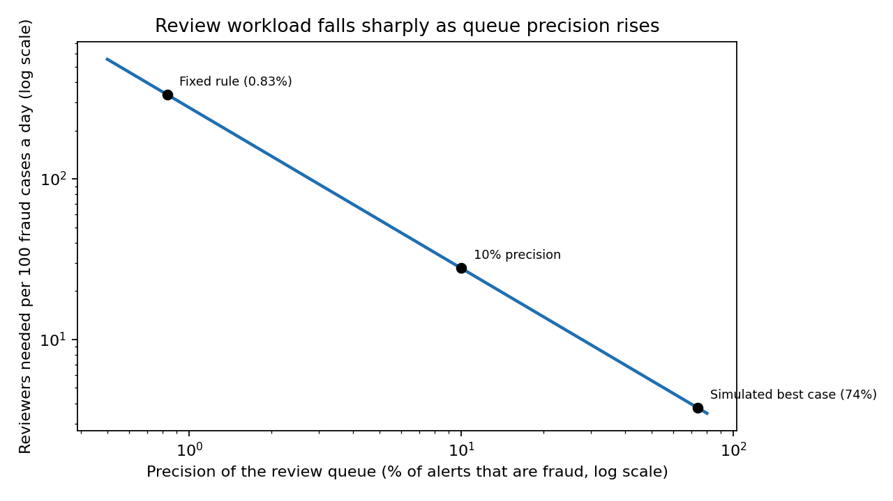

# Revolut growth and fraud review scaling model

## Question
Where did Revolut's 2025 growth come from, and what could reaching 100m customers mean for fraud review workload?

## Data
Revolut's reported 2025 figures (Revolut, 2026), with growth rates on a GBP basis. Review queue precision comes from my separate project, `fraud-ops-triage`, which used simulated PaySim transactions (Lopez-Rojas, Elmir and Axelsson, 2016).

## Method
1. **Growth per customer.** For each product line: (1 + revenue growth) divided by (1 + customer growth), minus 1.
2. **Customer target.** Growth needed to reach Revolut's stated goal of 100m customers by mid-2027.
3. **Reviewer need.** Reviewers needed scale with alerts per fraud case caught, which is 1 divided by queue precision. I test precision from 0.83% (a fixed rule) to 74% (the simulated ranked queue), assuming 36 reviews per analyst per day.

## Findings
- Group revenue per retail customer grew about 12% (revenue up 46%, customers up 30%).
- Subscriptions drove growth beyond customer numbers.

| Product line | Revenue growth per customer |
|---|---|
| Subscriptions | +28.5% |
| Card payments | +11.5% |
| FX | +10.0% |
| Wealth | +0.8% |
| Interest income | -5.4% |

- Reaching 100m customers by mid-2027 needs about 29% customer growth a year, close to the 30% achieved in 2025.
- A ranked review queue cuts reviewer need sharply, even at modest precision:

| Queue precision | Reviewers per 100 fraud cases a day | Saving vs fixed rule |
|---|---|---|
| 0.83% (fixed rule) | 335 | 0% |
| 5% | 56 | 83% |
| 10% | 28 | 92% |
| 25% | 11 | 97% |
| 74% (simulated) | 3.7 | 99% |



Written summary with a pilot proposal: `notes/revolut_scaling_fraud_review.md`.

## Limitations
- Revolut reports potential fraud cases reviewed daily rose 10x but gives no baseline, so I do not use it as an input.
- Real queue precision at Revolut's scale is unknown, which is why the model uses a range.
- Reported figures are rounded. Growth rates are GBP-based while some revenue levels are in USD, and product lines overlap, so they do not sum to group revenue.
- Retail customers are used as a proxy for the 100m customer target.
- Review time per alert is my assumption, and the model is proportional, so it ignores case complexity.

## Reproduce
```
pip install -r requirements.txt
python3 src/revolut_scaling_model.py
```
Or open `notebooks/Revolut_Scaling_Model.ipynb` and run all cells. Outputs are written to `outputs/`.

## References
Cavaglieri, C. (2025) 'Revolut still the worst UK firm for fraud complaints, warns Which?', *Which?*, 1 October. Available at: https://www.which.co.uk/news/article/revolut-still-the-worst-uk-firm-for-fraud-complaints-warns-which-axqr43W94wLn (Accessed: 11 October 2026).

Lopez-Rojas, E., Elmir, A. and Axelsson, S. (2016) 'PaySim: a financial mobile money simulator for fraud detection', *28th European Modeling and Simulation Symposium*, Larnaca, Cyprus.

Methri, G. (2023) 'Revolut doubles financial crime headcount to combat frauds', *IBS Intelligence*, 16 October. Available at: https://ibsintelligence.com/ibsi-news/revolut-doubles-financial-crime-headcount-to-combat-frauds/ (Accessed: 11 October 2026).

Revolut (2026) *Revolut reports record profit of $2.3bn for 2025 as revenue surges to $6bn*. Available at: https://www.revolut.com/en-AT/news/revolut_reports_record_profit_of_2_3bn_for_2025_as_revenue_surges_to_6bn/ (Accessed: 11 October 2026).
